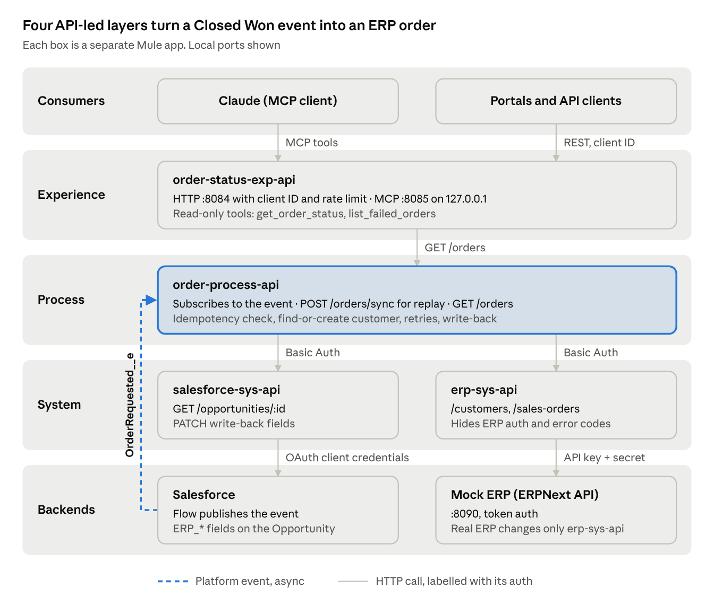
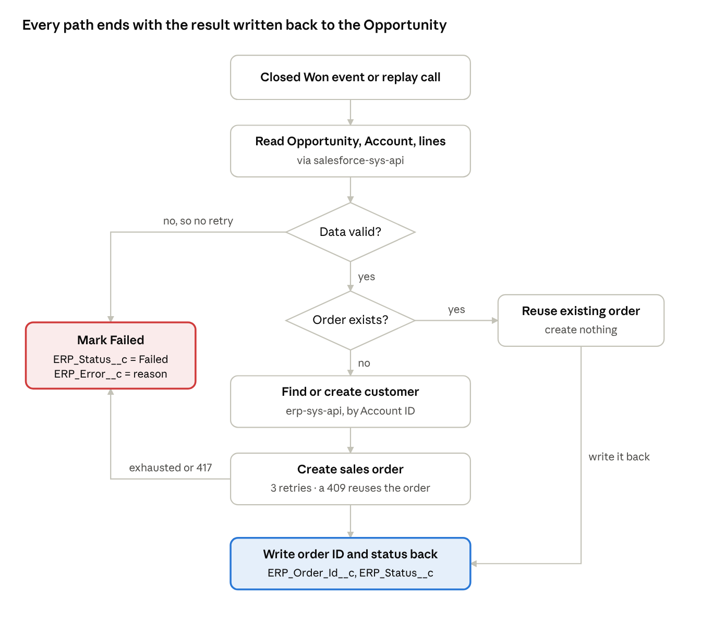
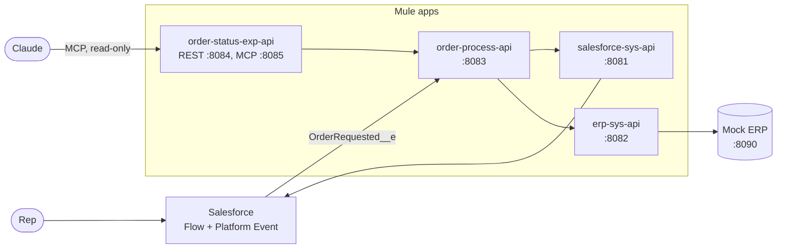

# Closed Won to ERP sales order

When a rep marks a Salesforce Opportunity as Closed Won, MuleSoft creates the customer and sales order in the ERP, then writes the order number and status back to the Opportunity. Claude can answer questions about orders through a read-only MCP server.

**What is real and what isn't**

| Part | Status |
|---|---|
| Salesforce org, Flow, Platform Event, write-back | Real, tested against a Developer Edition org |
| Four Mule apps on Mule 4.12 | Real, running locally |
| MCP server and Claude | Real, tested with a Claude session |
| ERP | **Mock.** It copies ERPNext's URLs, token auth and error codes. A real ERP would only change `erp-sys-api` |
| GitHub Actions | Written, not yet run |
| Exchange, API Manager | Done. All four APIs are in Exchange, with API Manager instances and policies applied |
| CloudHub 2.0 | **Blocked.** The trial business group has 0 vCores, so the deployment is rejected. See [platform setup](salesforceIntegration/docs/platform-setup.md) |
| Anypoint Monitoring | Not done |
| Agentforce | [Design note only](salesforceIntegration/docs/agentforce-note.md), not built |

## Architecture



Each box is a separate Mule app. The dashed line is the Salesforce Platform Event. Every other hop is a synchronous HTTP call, labelled with how it authenticates.

### Order sync logic



`order-process-api` runs this logic for both the Closed Won event and the `POST /orders/sync` replay call. Bad data fails fast with no retry, and transient ERP errors get 3 retries. A duplicate event creates nothing. Every outcome is written back to the Opportunity.

### APIs

| Layer | App | Local port | Endpoints | API Manager policy |
|---|---|---|---|---|
| Experience | `order-status-exp-api` | 8084 (REST), 8085 (MCP, 127.0.0.1 only) | `GET /orders/{opportunityId}/status`, `GET /orders/failed`, MCP tools `get_order_status` and `list_failed_orders` | Client ID Enforcement, Rate Limiting 60/min per client |
| Process | `order-process-api` | 8083 | Subscribes to `OrderRequested__e`; `POST /orders/sync`, `GET /orders`, `GET /orders/{opportunityId}` | HTTP Basic Authentication |
| System | `salesforce-sys-api` | 8081 | `GET /opportunities`, `GET` and `PATCH /opportunities/{opportunityId}` | HTTP Basic Authentication |
| System | `erp-sys-api` | 8082 | `GET`/`POST /customers`, `GET`/`POST /sales-orders`, `GET /sales-orders/{orderId}` | HTTP Basic Authentication |
| Backend | Mock ERP (Node) | 8090 | ERPNext-style `/api/resource/Customer` and `/api/resource/Sales Order` | Token auth (`ERP_API_KEY:ERP_API_SECRET`) |

### Text version of the diagram



The event carries only the Opportunity ID, so the process API always reads current data. The event connection is outbound from Mule, so no tunnel is needed. The [design](salesforceIntegration/docs/design.md) has the sequence diagram, field mapping and failure cases.

## Repo layout

```text
order-process-api/        Process API: event listener, order logic, MUnit tests
salesforceIntegration/
  apis/salesforce-sys-api/    System API: read Opportunities, write ERP results
  apis/erp-sys-api/           System API: customers and sales orders. Hides the ERP
  apis/order-status-exp-api/  Experience API: read-only REST and MCP tools
  docs/                   Design, runbook, platform setup, Agentforce note
  mock-erp/               The mock ERP and its tests
  salesforce/             Salesforce metadata
  scripts/                Run, seed, test and publish
  specs/                  OpenAPI specs
.github/workflows/        Build, MUnit, gated deploy
```

## Run it

You need Anypoint Code Builder, which supplies the Mule runtime, JDK and Maven, plus Node 18 or later and a Salesforce org set up as in [Day 1 setup](salesforceIntegration/docs/day-1-setup.md).

```powershell
copy .env.example .env                  # Then fill in your External Client App values
cd salesforceIntegration
.\scripts\run-local.ps1                 # Build and start everything. Takes a few minutes
```

In a second terminal:

```powershell
.\scripts\seed-salesforce.ps1           # Creates products, an Account and an Opportunity
.\scripts\e2e-test.ps1                  # Runs every case against the real org
```

Open the apps in VS Code with `muleProjects.code-workspace`, so each one is its own project and the visual canvas works.

## Connect Claude

The stack must be running. `.mcp.json` at the repo root registers the server for Claude Code:

```powershell
claude "Which orders failed today, and why?"
```

The two tools are `get_order_status` and `list_failed_orders`. Claude has no tool that can change an order.

## Tests

| Test | Covers | Result |
|---|---|---|
| MUnit, 5 tests (`mvn test` in `order-process-api`) | Happy path, existing customer, duplicate event, ERP rejection, ERP outage with retries | All pass |
| `scripts/e2e-test.ps1`, 10 cases | The same paths through real Salesforce, plus replay and the status API | All pass |
| `scripts/mcp-check.mjs` | MCP handshake and tools, including rejecting a malformed ID | Works as expected |
| `mock-erp/test.mjs` | The mock's behaviour | Included in CI |

To check that the MUnit tests can fail, I temporarily disabled the duplicate check. Only `duplicate-event-creates-nothing` failed.

## Decisions worth a look

- **Retries cover more than timeouts.** A stopped ERP gives a connection error, not a timeout, so retrying only timeouts would miss the most common outage. Retrying a create is safe because the code looks for the order first.
- **No error queue.** The failed Opportunity is the error record, so reps see it in Salesforce and `list_failed_orders` can query it. A replay needs only the Opportunity ID.
- **External Client App, not a Connected App,** because new Connected Apps are off by default.
- **Native MCP connector.** The tools run inside the Mule app rather than in a separate wrapper service.

## How I used Claude

**Claude drafted:** the design, OpenAPI specs, DataWeave mappings, Mule flows, mock ERP, MUnit suite, MCP tools, scripts, pipeline and docs.

**How I checked it:** I didn't rely on Claude's description of the code. I ran it against a real Salesforce org and tested the failure cases by breaking things on purpose. The [runbook](salesforceIntegration/docs/runbook.md) has the log output.

**Where checking mattered:**

| Problem | How it was caught |
|---|---|
| Closing a deal did nothing, because Mule had saved the event listener as stopped from an earlier run. The app looked healthy and logged no errors | Testing the real Closed Won path. Replaying through the API had passed, which hid it |
| The first end-to-end script passed its duplicate-order check without really testing it, because of how PowerShell counts JSON arrays | A result that looked wrong in the output: "1 failed today" when at least two had |
| Rewriting `config.yaml` added a byte-order mark that stopped two apps from deploying | The deployment error |
| A build reported success when no MUnit tests had run, because the step adding them had failed | Checking the test count rather than `BUILD SUCCESS` |

**Safety:** Claude reaches only the read-only Experience API, on a local port, and the model-supplied ID is validated before it goes near a URL. Secrets stay in a gitignored `.env`.
