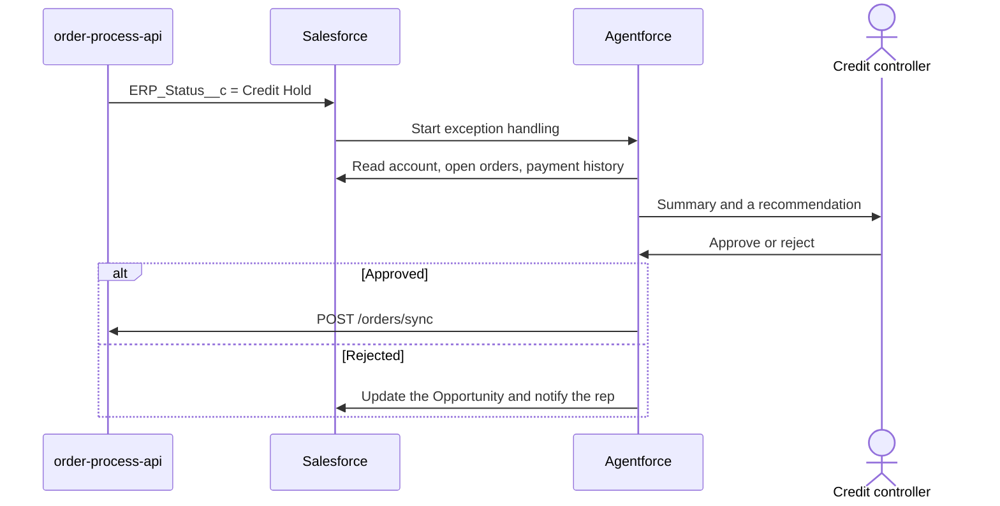

# Where Agentforce Operations would fit

**Status: design only, not built.** Nothing in this repo uses Agentforce. I have not checked this design against a live Agentforce org, so the product details need confirming before anyone builds it.

## The gap

MuleSoft handles the path where a rule decides the outcome: create the order, retry an outage, mark bad data as `Failed`. It stops where a person has to make a judgment. The clearest example is a credit hold, where the ERP refuses an order because the customer is over their credit limit.

Today that order becomes `ERP_Status__c = Failed` with a reason, and it waits until someone notices it.

## The proposal

Add a step that routes the exception to the right person, gives them the context, and acts on their decision.

## What would change

| Area | Change |
|---|---|
| `erp-sys-api` | Return a distinct `CREDIT_HOLD` error instead of a general rejection |
| `order-process-api` | Set `ERP_Status__c = Credit Hold`, not `Failed` |
| Salesforce | Add the new status value and start the agent when a record gets it |
| Replay | No change. `POST /orders/sync` is already safe to repeat |

## Guardrails

- **A person decides.** The agent summarises and recommends. It cannot release an order on its own.
- **Narrow access.** Its only write action is the replay endpoint, through its own credentials, and it never reaches the ERP directly.
- **Audit trail.** Record who approved each release, when, and what the agent recommended.
- **Fallback.** If the agent is unavailable, the order stays on hold and visible in Salesforce. Nothing is released by default.

## Why not use an agent for everything

Order creation should stay deterministic. A rule that gives the same answer every time is cheaper, easier to test and easier to audit. An agent is worth adding only where the alternative is a person gathering context by hand.
