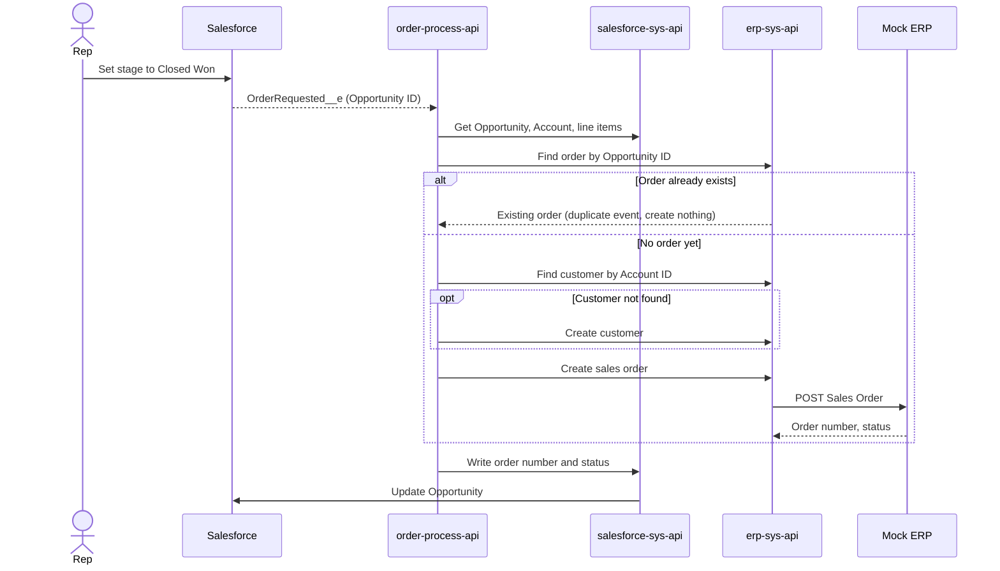

# Design: Closed Won Opportunity creates an ERP sales order

When a rep marks an Opportunity Closed Won, MuleSoft creates the customer and sales order in the ERP, then writes the order number and status back to the Opportunity. A read-only API lets Claude answer questions about orders through MCP.

**The ERP is a mock.** It copies ERPNext's URLs, token auth and error codes, so a real ERP would only change `erp-sys-api`.

## Flow

## API layers

| Layer | API | Job |
|---|---|---|
| System | `salesforce-sys-api` | Read Opportunities, write ERP results |
| System | `erp-sys-api` | Customers and sales orders. Hides the ERP |
| Process | `order-process-api` | Subscribes to the event and runs the order logic |
| Experience | `order-status-exp-api` | Read-only status, exposed to Claude through MCP |

The event carries only the Opportunity ID. The process API reads the rest, so it always works from current data, including line items.

## Field mapping

| Salesforce | ERP Sales Order | Rule |
|---|---|---|
| `Opportunity.Id` | `custom_sf_opportunity_id` | Idempotency key. Unique |
| `Account.Id` | `Customer.custom_sf_account_id` | Used to find the customer |
| `Account.Name` | `Customer.customer_name` | Set when creating a customer |
| None | `transaction_date` | Today. `CloseDate` can be in a closed fiscal year, which ERPNext rejects |
| None | `delivery_date` | Today + 14 days, set by a property |
| `OpportunityLineItem.ProductCode` | `items[].item_code` | Must match an ERP item |
| `OpportunityLineItem.Quantity` | `items[].qty` | Direct |
| `OpportunityLineItem.UnitPrice` | `items[].rate` | Direct |

Written back to the Opportunity:

| ERP result | Salesforce field |
|---|---|
| Order name | `ERP_Order_Id__c` |
| Order status, or `Failed` | `ERP_Status__c` |
| Failure reason | `ERP_Error__c` |
| Time of the attempt | `ERP_Synced_At__c` |

## Failure cases

| Case | How it shows up | What happens |
|---|---|---|
| ERP down or slow | Timeout, connection error, 502, 503 | Retry 3 times with a delay, then mark `Failed` |
| Duplicate event | Order already found | Create nothing, write the existing order back |
| Two copies at once | 409 on create | Look up the existing order and continue |
| Customer already exists | Customer found by Account ID | Reuse it |
| Bad data: no Account, no line items | Checked before calling the ERP | No retry, mark `Failed` with the reason |
| Bad data: unknown product | 417 from the ERP | No retry, mark `Failed` with the reason |
| Salesforce write-back fails | Error from `salesforce-sys-api` | Retry, then log an error and alert. Replaying is safe |

**Why more than timeouts are retried.** A stopped ERP gives a connection error, not a timeout. Retrying a create is safe because the code looks for the order first and the Opportunity ID is unique.

**Why there is no error queue.** The failed Opportunity is the error record, so reps can see it in Salesforce and `list_failed_orders` can query it. To replay one, call `POST /orders/sync`. This needs only the Opportunity ID.

## Security

- **Salesforce:** an External Client App using OAuth Client Credentials, running as a dedicated user. New Connected Apps are off by default.
- **ERP:** API key and secret, kept in secure properties and never committed.
- **APIs:** client ID enforcement on all of them, plus rate limiting on the Experience API.
- **AI:** Claude reaches only the read-only Experience API, so it cannot change orders. The MCP listener binds to `127.0.0.1`, because API Manager policies do not cover it.
- **Logs:** Opportunity and order IDs only, with no customer data.

## Limits

- The mock keeps data in memory, so a restart clears it.
- The event listener must run on one replica. Multiple CloudHub replicas would each consume every event.
- Salesforce keeps events for 72 hours, so a longer outage needs a manual replay.
- This assumes one currency.
